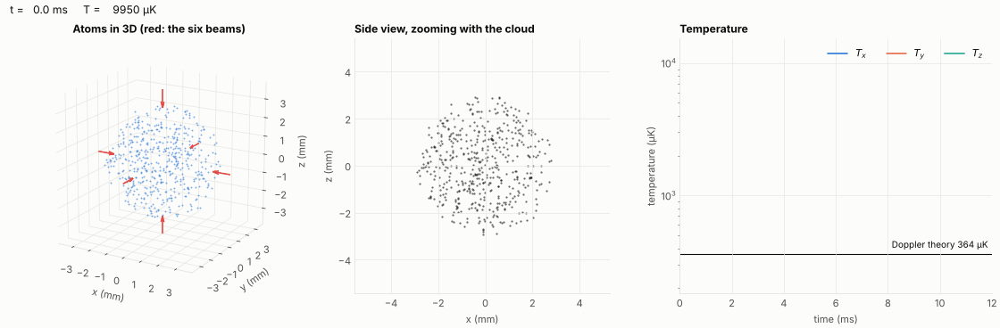
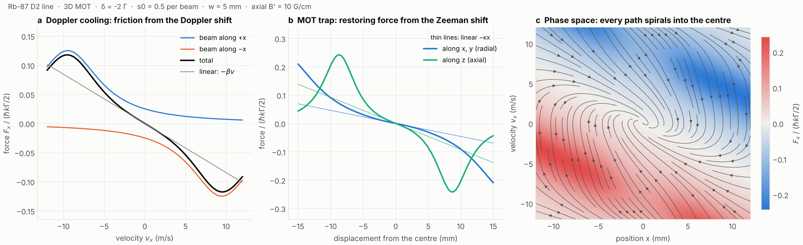
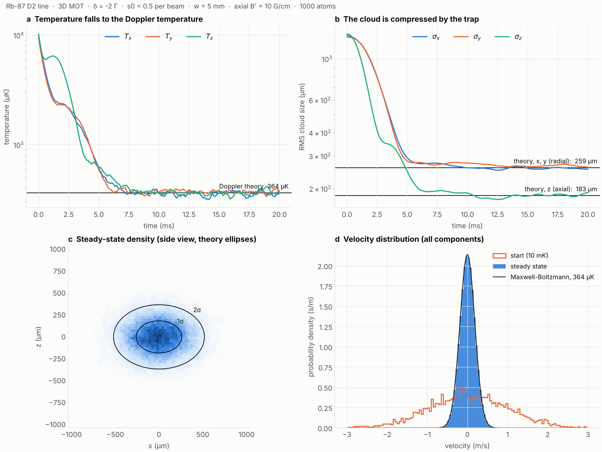
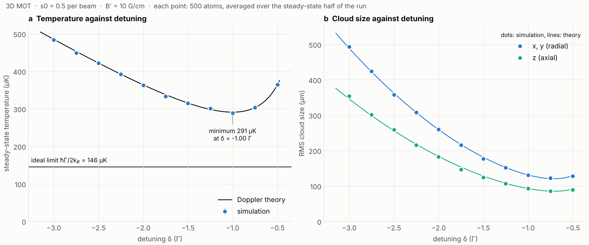
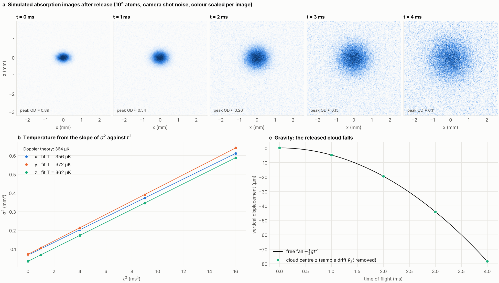
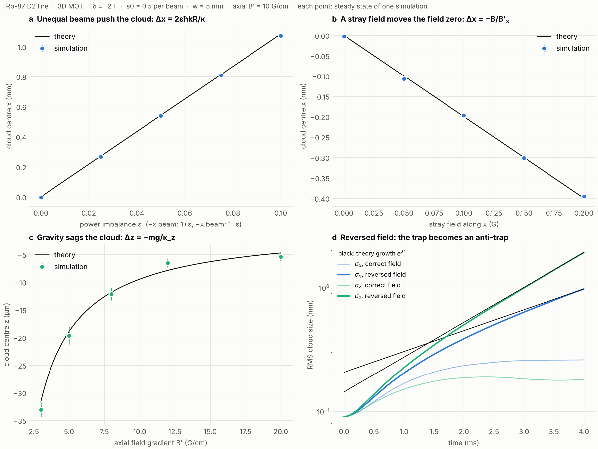
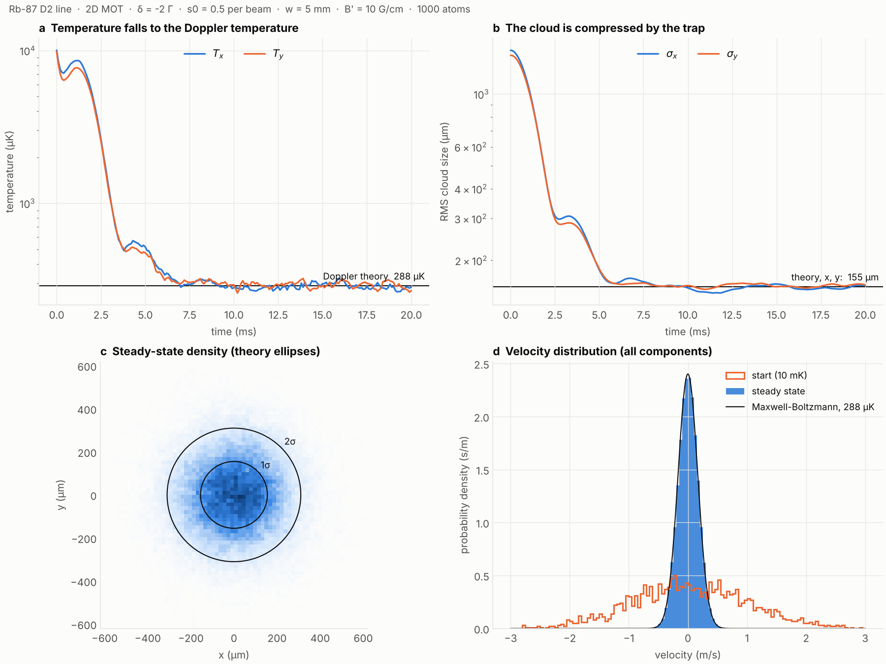
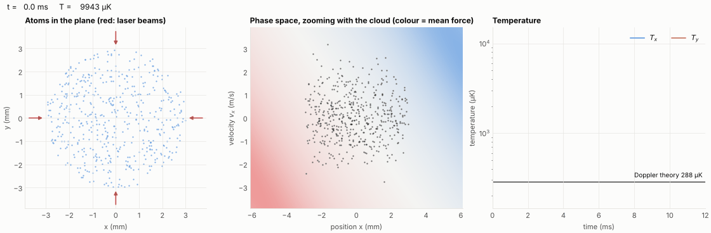

# Simulating and Visualizing Laser Cooling of Rubidium-87 in a MOT

A Monte-Carlo simulation of Rb-87 atoms in a **magneto-optical trap (MOT)**. The default is a
**3D MOT**; a **2D MOT** is available with `--dimensions 2`.

Every atom scatters photons one at a time. Each absorption and spontaneous emission gives it a
recoil kick of $\hbar k$. Averaged over many photons, these kicks produce the friction that cools
the atoms and the restoring force that traps them. Their randomness produces the heating that sets
the final temperature.

Every result is checked against analytic Doppler-cooling theory. The project also simulates what an
experiment would measure (time-of-flight expansion and absorption images) and what goes wrong in a
real setup (unequal beams, stray fields, gravity, a reversed coil).



## Quick start

```bash
pip install -r requirements.txt
python main.py                      # 3D MOT, all figures (about 10 min)
python main.py --dimensions 2       # 2D MOT
python main.py --quick              # main simulation only (about 30 s)
python main.py --help               # detuning, intensity, gradient, atoms, ...
python -m pytest                    # physics checks (20 tests)
```

Figures are written to `figures/3d/` and `figures/2d/`.

## The physical model

### Geometry

| | 3D MOT (default) | 2D MOT |
|---|---|---|
| beams | 6, along ±x, ±y, ±z | 4, along ±x, ±y |
| magnetic field | anti-Helmholtz coils: $B = B'(x/2,\ y/2,\ -z)$ | 2D quadrupole: $B = B'(x,\ -y)$ |
| field gradient | axial (z) gradient $B'$ is twice the radial one | equal on both axes |
| gravity | along −z | none (z is the free axis) |

All beams are red-detuned by $\delta$ from the Rb-87 D2 cycling transition
$|F=2, m_F=2\rangle \to |F'=3, m_{F'}=3\rangle$ (λ = 780.24 nm, Γ = 2π × 6.07 MHz).

### Scattering rate

An atom at position $\mathbf r$ with velocity $\mathbf v$ scatters photons from beam $j$
(direction $\hat e_j$) at the rate

$$
R_j = \frac{\Gamma}{2}\,\frac{s_j}{1 + s_\text{tot} + (2\delta_j/\Gamma)^2},
\qquad
\delta_j = \delta - \hat e_j\cdot\bigl(k\mathbf v + \mathbf G \circ (\mathbf r - \mathbf r_0)\bigr),
$$

where

- $s_j = s_0\,P_j\,e^{-2r_\perp^2/w^2}$ is the local saturation of the Gaussian beam ($P_j$ = relative power),
- $s_\text{tot} = \sum_j s_j$, because all beams drive the same transition,
- $G_i = \mu' B'_i/\hbar$ is the Zeeman shift per unit displacement along axis $i$,
- $\mathbf r_0$ is the zero of the magnetic field (the origin, unless there is a stray field).

Two effects shift the detuning $\delta_j$:

- **Doppler shift ($k\mathbf v$).** An atom moving against a red-detuned beam sees it closer to
  resonance, so it scatters more from that beam and is slowed. This is the friction.
- **Zeeman shift ($\mathbf G \circ \mathbf r$).** With σ± polarisations, an atom displaced from the
  field zero is shifted closer to resonance with the beam that pushes it back. This is the trap.

### Time evolution

In each time step $\Delta t$ = 1 µs:

1. The number of photons absorbed from each beam is drawn from a Poisson distribution with mean
   $R_j \Delta t$. Each absorbed photon gives a kick of $\hbar k\,\hat e_j$.
2. Each absorbed photon is re-emitted in a random isotropic 3D direction, which gives a second kick.
   In 2D only its in-plane part is kept.
3. The velocity is updated with the kicks and gravity, then $\mathbf x \mathrel{+}= \mathbf v\,\Delta t$.

No force is put in by hand. Friction, trapping and heating all come from these photon kicks.



### Analytic predictions (`mot/theory.py`)

For small velocity and displacement, the force along each axis is linear,
$F_i = -\beta v_i - \kappa_i x_i$, with $D = 1 + s_\text{tot} + (2\delta/\Gamma)^2$:

| Quantity | Formula | 3D default |
|---|---|---|
| friction coefficient | $\beta = -8\hbar k^2 s_0 (\delta/\Gamma) / D^2$ | $m/\beta$ = 1.06 ms |
| spring constant | $\kappa_i = \beta\,\mu' B'_i / \hbar k$ | $\omega/2\pi$ = 114 Hz radial, 162 Hz axial |
| momentum diffusion | $2D_p = (\hbar k)^2 R\,(2 + 2D\cdot\tfrac13)$ | absorption + projected emission |
| temperature | $k_B T = D_p / \beta$ | 364 µK |
| cloud size | $\sigma_i = \sqrt{k_B T/\kappa_i}$ | 259 µm radial, 183 µm axial |
| gravitational sag | $\Delta z = -mg/\kappa_z$ | −9.5 µm |

In 3D, the diffusion term $2 + 6\cdot\tfrac13 = 4$ is exactly the textbook 1D result, giving
$k_B T = \frac{\hbar\Gamma}{4}\,\frac{1 + s_\text{tot} + (2\delta/\Gamma)^2}{2|\delta|/\Gamma}$.

- **Optimal detuning.** The minimum temperature is reached at
  $\delta = -\tfrac{\Gamma}{2}\sqrt{1+s_\text{tot}}$. The textbook limit $\hbar\Gamma/2k_B$ = 146 µK
  only holds at low intensity.
- **Cloud shape.** Because the axial trap is twice as stiff, the cloud is flattened by $\sqrt 2$
  along z.

## Results (3D MOT)

Default parameters: δ = −2Γ, $s_0$ = 0.5 per beam, w = 5 mm, axial B′ = 10 G/cm, 1000 atoms
starting at 10 mK in a 3 mm ball.



| | theory | simulation |
|---|---|---|
| temperature | 364 µK | 364 µK (x 356, y 373, z 362) |
| RMS size, radial (x, y) | 259 µm | 257 µm, 266 µm |
| RMS size, axial (z) | 183 µm | 182 µm |

Scanning the detuning shows the trade-off:

- **Small |δ|:** friction weakens ($\beta \propto \delta$) while the heating does not, so the cloud
  gets hotter.
- **Large |δ|:** both friction and trapping fade, so the cloud gets hotter and larger.



### Measuring like an experiment (`mot/measurement.py`)

In the lab, temperature is measured by **time of flight**:

1. Switch off the light and the field.
2. Let the cloud expand for a time $t$, then take an absorption image.
3. Fit $\sigma^2(t) = \sigma_0^2 + (k_B T/m)\,t^2$. The slope gives the temperature.

The simulated images use the column density of $10^6$ atoms, the resonant cross-section
$\sigma_0 = 3\lambda^2/2\pi$, a 15 µm imaging resolution and camera shot noise.



### What goes wrong in a real MOT (`mot/studies.py`)

Each point is the steady state of a separate simulation; the lines are the analytic predictions.

- **a. Power imbalance.** If the +x beam carries $1+\varepsilon$ and the −x beam $1-\varepsilon$, the
  net push $2\varepsilon\hbar k R$ moves the cloud by $\Delta x = 2\varepsilon\hbar k R/\kappa_x$.
  A 10% imbalance moves it by about 1 mm.
- **b. Stray field.** A uniform field $B$ moves the field zero, and the cloud with it, by
  $\Delta x = -B/B'_x$.
- **c. Gravity.** The cloud sags by $mg/\kappa_z$. This is only a few µm for Rb, because the
  radiation force is much larger than gravity.
- **d. Reversed field.** Reversing the coil current (or the σ± handedness) turns the trap into an
  anti-trap. The cloud then grows as $e^{\lambda t}$ with
  $\lambda = -\gamma/2 + \sqrt{\gamma^2/4 + |\kappa|/m}$.



## 2D MOT

`python main.py --dimensions 2` runs the same physics with four beams in the x–y plane. A 2D MOT
cools and traps transversely and leaves z free; it is commonly used as a source to load a 3D MOT.
With the default parameters, theory gives 288 µK and 155 µm, and the simulation gives
285 µK and 292 µK along x and y, and 153 µm and 157 µm.

| | |
|---|---|
|  |  |

## What the model leaves out

These approximations are deliberate. They matter when comparing with an experiment:

- **Two-level atom.** Sub-Doppler (polarisation-gradient) cooling, which brings real Rb MOTs to
  tens of µK, is not captured. Optical pumping and the repumper are also not modelled.
- **Rate equations.** Interference between beams and optical coherences are ignored; this is valid
  for times much longer than 1/Γ.
- **Zeeman shift.** The shift is taken linear along each beam axis, with the effective moment of the
  stretched transition ($\mu' = \mu_B$).
- **Single atoms.** Light-assisted collisions, re-scattering and shadowing between atoms are
  ignored. These limit the density of real MOTs, so in this model the cloud size does not depend on
  the atom number.

## Code layout

```
main.py                 command-line entry point: run, print summary, make figures
mot/
  constants.py          physical constants and Rb-87 D2 data (Steck)
  parameters.py         MOTParameters: geometry, laser, field, imperfections
  physics.py            scattering rates, mean force, random photon kicks
  simulation.py         time evolution, temperature, size and centre of the cloud
  theory.py             analytic Doppler-theory predictions
  studies.py            parameter scans (detuning, imperfections, anti-trap)
  measurement.py        time-of-flight expansion and absorption images
  visualization.py      figures and animations
tests/test_physics.py   simulation compared with theory, in 2D and 3D
```
