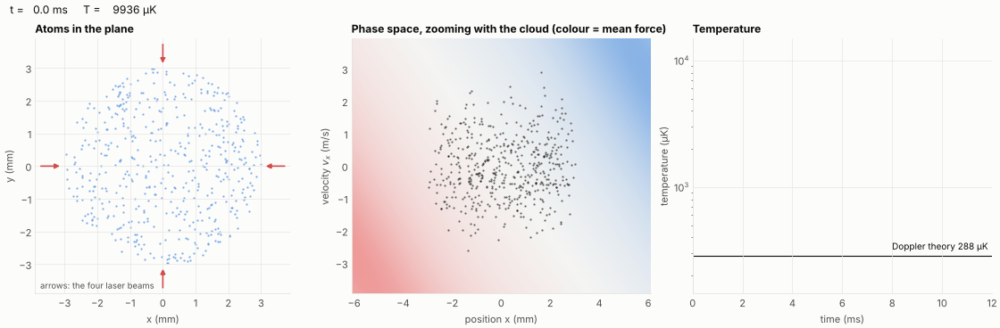
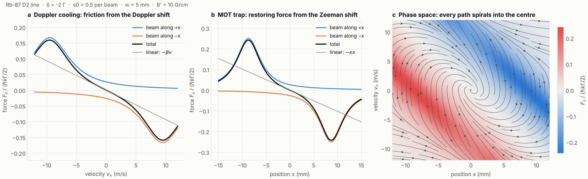
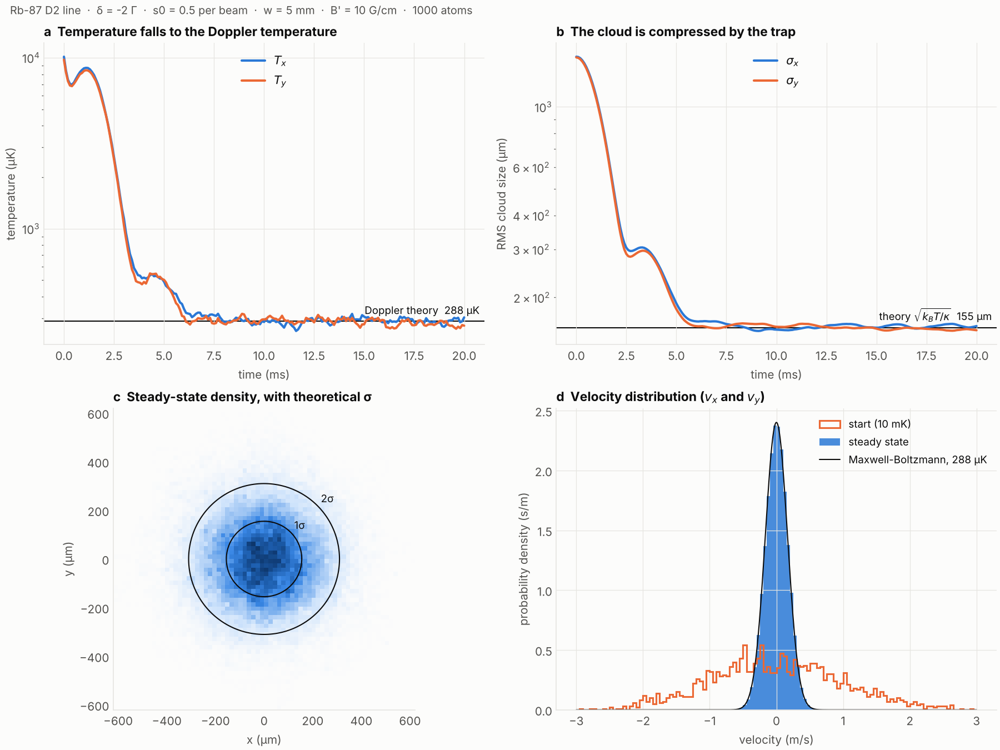
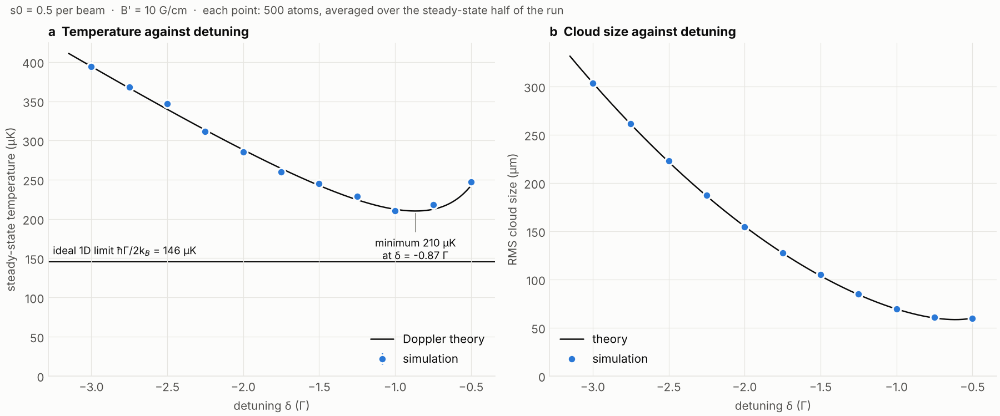

# Simulating and Visualizing 2D Laser Cooling of Rubidium-87

A Monte-Carlo simulation of Rb-87 atoms in a **two-dimensional magneto-optical trap (2D MOT)**.
Every atom scatters photons one at a time. Each absorption and spontaneous emission gives it a
recoil kick of $\hbar k$. Averaged over many photons, these kicks produce the friction that cools
the atoms and the restoring force that traps them. Their randomness produces the heating that sets
the final temperature.

The simulation is checked against analytic Doppler-cooling theory: the steady-state temperature
and cloud size agree to within about 1%.



## Quick start

```bash
pip install -r requirements.txt
python main.py                      # all figures, about 1.5 min
python main.py --detuning -1.5      # other parameters: see python main.py --help
python -m pytest                    # physics checks
```

## The physical model

### Setup

Four laser beams travel along $+x$, $-x$, $+y$ and $-y$. They are red-detuned by $\delta$ from the
Rb-87 D2 cycling transition $|F=2, m_F=2\rangle \to |F'=3, m_{F'}=3\rangle$
(λ = 780.24 nm, Γ = 2π × 6.07 MHz). A 2D quadrupole field $B = B'(x, -y)$ is zero on the
trap axis. Motion along $z$, the free axis of a 2D MOT, is not simulated.

### Scattering rate

An atom at position $\mathbf r$ with velocity $\mathbf v$ scatters photons from beam $j$
(direction $\hat e_j$) at the rate

$$
R_j = \frac{\Gamma}{2}\,\frac{s_j}{1 + s_\text{tot} + (2\delta_j/\Gamma)^2},
\qquad
\delta_j = \delta - \hat e_j\cdot\Bigl(k\mathbf v + \frac{\mu' B'}{\hbar}\mathbf r\Bigr),
$$

where

- $s_j = s_0\,e^{-2r_\perp^2/w^2}$ is the local saturation of the Gaussian beam,
- $s_\text{tot} = \sum_j s_j$, because all beams drive the same transition,
- $\delta_j$ is the detuning the atom sees from beam $j$.

Two effects shift $\delta_j$:

- **Doppler shift ($k\mathbf v$).** An atom moving against a red-detuned beam sees it closer to
  resonance, so it scatters more from that beam and is slowed. This is the friction.
- **Zeeman shift ($\mu' B' \mathbf r/\hbar$).** With σ± polarisations, an atom displaced from the
  centre is shifted closer to resonance with the beam that pushes it back. This is the trap.

Both shifts enter $\delta_j$ in the same way, so the MOT force depends only on
$\mathbf v + (\mu'B'/\hbar k)\,\mathbf r$.

### Time evolution

In each time step $\Delta t$ = 1 µs:

1. The number of photons absorbed from each beam is drawn from a Poisson distribution with mean
   $R_j \Delta t$. Each absorbed photon gives a kick of $\hbar k\,\hat e_j$.
2. Each absorbed photon is re-emitted in a random isotropic **3D** direction. The projection of
   that kick onto the $xy$ plane is applied.
3. The velocity is updated with the kicks, then $\mathbf x \mathrel{+}= \mathbf v\,\Delta t$.

No force is put in by hand. Friction, trapping and heating all come from these photon kicks.



### Analytic predictions (`mot2d/theory.py`)

For small velocity and displacement, the force along each axis is linear, $F = -\beta v - \kappa x$,
with $D = 1 + s_\text{tot} + (2\delta/\Gamma)^2$:

| Quantity | Formula | Default value |
|---|---|---|
| friction coefficient | $\beta = -8\hbar k^2 s_0 (\delta/\Gamma) / D^2$ | $m/\beta$ = 0.95 ms |
| spring constant | $\kappa = \beta\,\mu' B' / \hbar k$ | $\omega/2\pi$ = 170 Hz, ζ = 0.49 |
| momentum diffusion | $2D_p = (\hbar k)^2 R\,(2 + 4\cdot\tfrac13)$ | absorption + projected emission |
| temperature | $k_B T = D_p / \beta$ | 288 µK |
| cloud size | $\sigma = \sqrt{k_B T/\kappa}$ | 155 µm |

The minimum temperature is reached at $\delta = -\tfrac{\Gamma}{2}\sqrt{1+s_\text{tot}}$.
The textbook limit $\hbar\Gamma/2k_B$ = 146 µK only holds in 1D, at low intensity and at
δ = −Γ/2.

## Results

Default parameters: δ = −2Γ, $s_0$ = 0.5 per beam, w = 5 mm, B′ = 10 G/cm, 1000 atoms starting at
10 mK in a 3 mm disc.



|  | theory | simulation |
|---|---|---|
| temperature | 288 µK | 287 µK |
| RMS cloud size | 155 µm | 155 µm |

Scanning the detuning shows the trade-off:

- **Small |δ|:** friction weakens ($\beta \propto \delta$) while the heating does not, so the cloud
  gets hotter.
- **Large |δ|:** both friction and trapping fade, so the cloud gets hotter and larger.



## What the model leaves out

These approximations are deliberate. They matter when comparing with an experiment:

- **Two-level atom.** Sub-Doppler (polarisation-gradient) cooling, which brings real Rb MOTs to
  tens of µK, is not captured. Optical pumping and the repumper are also not modelled.
- **Rate equations.** Interference between beams and optical coherences are ignored; this is valid
  for times much longer than 1/Γ.
- **Zeeman shift.** The shift is taken linear along each beam axis, with the effective moment of the
  stretched transition ($\mu' = \mu_B$).
- **Single atoms.** Light-assisted collisions, re-scattering and shadowing between atoms are
  ignored. These limit the density of real MOTs.
- **No gravity.** Motion along $z$ is not simulated.

## Code layout

```
main.py                 command-line entry point: run, print summary, make figures
mot2d/
  constants.py          physical constants and Rb-87 D2 data (Steck)
  parameters.py         MOTParameters: detuning, saturation, waist, field gradient
  physics.py            scattering rates, mean force, random photon kicks
  simulation.py         time evolution, temperature and size, detuning scan
  theory.py             analytic Doppler-theory predictions
  visualization.py      figures and animation
tests/test_physics.py   simulation compared with theory
```
