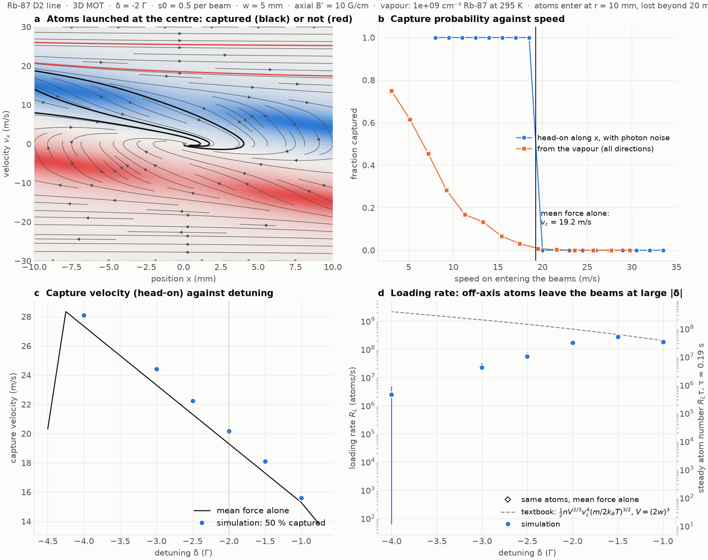
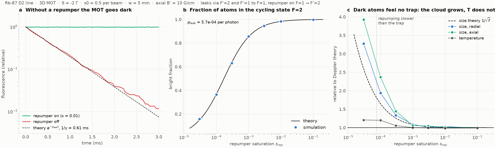
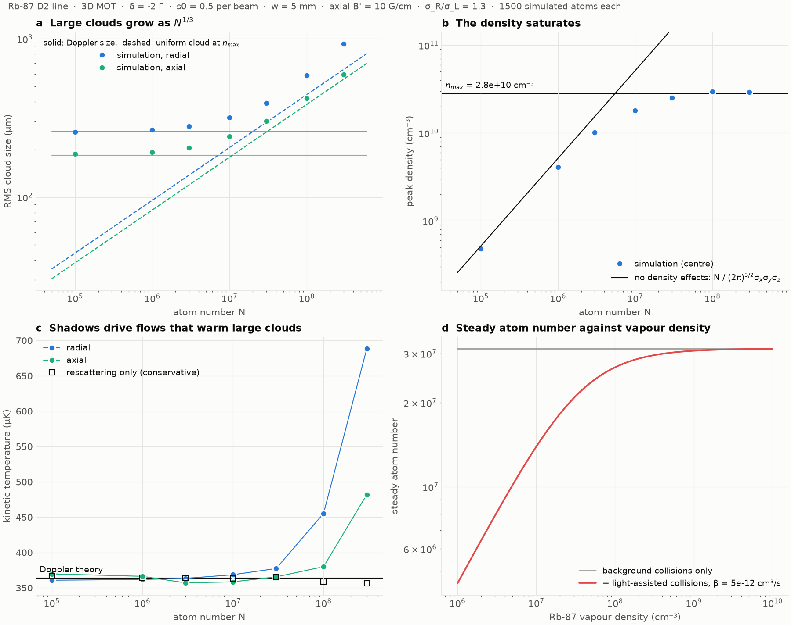
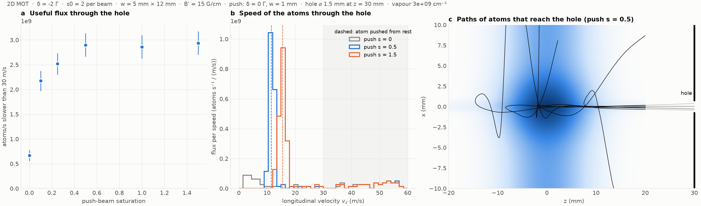
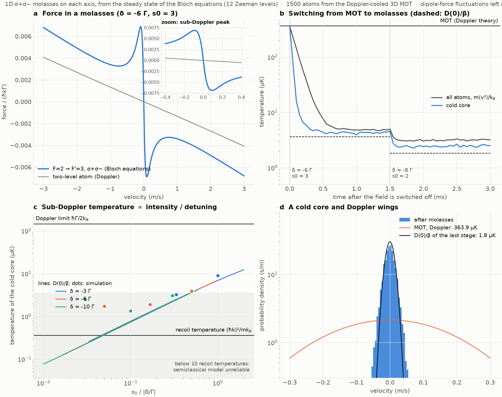

# Simulating and Visualizing Laser Cooling of Rubidium-87 in a MOT

A Monte-Carlo simulation of Rb-87 atoms in a **magneto-optical trap (MOT)**. The default is a
**3D MOT**; a **2D MOT** is available with `--dimensions 2`.

Every atom scatters photons one at a time. Each absorption and spontaneous emission gives it a
recoil kick of $\hbar k$. Averaged over many photons, these kicks produce the friction that cools
the atoms and the restoring force that traps them. Their randomness produces the heating that sets
the final temperature.

Every result is checked against analytic Doppler-cooling theory. The project also simulates what an
experiment would measure (time-of-flight expansion and absorption images) and what goes wrong in a
real setup (unequal beams, stray fields, gravity, a reversed coil).


## Quick start

```bash
pip install -r requirements.txt
python main.py                      # 3D MOT, all figures (about 2 min)
python main.py --dimensions 2       # 2D MOT
python main.py --quick              # main simulation only (about 4 s)
python main.py --help               # detuning, intensity, gradient, atoms, ...
python extensions.py                # capture, repumper, density limit, 2D-MOT source, molasses (about 3 min)
python extensions.py --quick        # the same with fewer atoms (about 1 min)
python -m pytest                    # physics checks (39 tests)
```

Figures are written to `figures/3d/`, `figures/2d/` and `figures/extensions/`.
Times are for an Apple M2 (4 performance + 4 efficiency cores).

### Speed

Two things make the simulation fast; neither changes the physics.

- **Compiled inner loop** (`mot/fast.py`). With [Numba](https://numba.pydata.org) installed, the
  photon-by-photon loop runs as compiled code, one atom per thread, many time steps per call. Each
  atom draws from its own random stream, so a run gives the same result on any number of threads.
  Without Numba, or with `MOT_NUMBA=0`, the same loop runs in NumPy.
- **Parallel scans** (`mot/parallel.py`). Each point of a parameter scan is a separate
  simulation, and scans run one per CPU core. `MOT_PROCESSES=1` runs them one after another.

Numba draws different random numbers from NumPy, so the results agree statistically, not digit for
digit. The tests pass both ways.

## The physical model

### Geometry

| | 3D MOT (default) | 2D MOT |
|---|---|---|
| beams | 6, along ±x, ±y, ±z | 4, along ±x, ±y |
| magnetic field | anti-Helmholtz coils: $B = B'(x/2,\ y/2,\ -z)$ | 2D quadrupole: $B = B'(x,\ -y)$ |
| field gradient | axial (z) gradient $B'$ is twice the radial one | equal on both axes |
| gravity | along −z | none (z is the free axis) |

All beams are red-detuned by $\delta$ from the Rb-87 D2 cycling transition
$|F=2, m_F=2\rangle \to |F'=3, m_{F'}=3\rangle$ (λ = 780.24 nm, Γ = 2π × 6.07 MHz).

### Scattering rate

An atom at position $\mathbf r$ with velocity $\mathbf v$ scatters photons from beam $j$
(direction $\hat e_j$) at the rate

$$
R_j = \frac{\Gamma}{2}\,\frac{s_j}{1 + s_\text{tot} + (2\delta_j/\Gamma)^2},
\qquad
\delta_j = \delta - \hat e_j\cdot\bigl(k\mathbf v + \mathbf G \circ (\mathbf r - \mathbf r_0)\bigr),
$$

where

- $s_j = s_0\,P_j\,e^{-2r_\perp^2/w^2}$ is the local saturation of the Gaussian beam ($P_j$ = relative power),
- $s_\text{tot} = \sum_j s_j$, because all beams drive the same transition,
- $G_i = \mu' B'_i/\hbar$ is the Zeeman shift per unit displacement along axis $i$,
- $\mathbf r_0$ is the zero of the magnetic field (the origin, unless there is a stray field).

Two effects shift the detuning $\delta_j$:

- **Doppler shift ($k\mathbf v$).** An atom moving against a red-detuned beam sees it closer to
  resonance, so it scatters more from that beam and is slowed. This is the friction.
- **Zeeman shift ($\mathbf G \circ \mathbf r$).** With σ± polarisations, an atom displaced from the
  field zero is shifted closer to resonance with the beam that pushes it back. This is the trap.

### Time evolution

In each time step $\Delta t$ = 1 µs:

1. The number of photons absorbed from each beam is drawn from a Poisson distribution with mean
   $R_j \Delta t$. Each absorbed photon gives a kick of $\hbar k\,\hat e_j$.
2. Each absorbed photon is re-emitted in a random isotropic 3D direction, which gives a second kick.
   In 2D only its in-plane part is kept.
3. The velocity is updated with the kicks and gravity, then $\mathbf x \mathrel{+}= \mathbf v\,\Delta t$.

No force is put in by hand. Friction, trapping and heating all come from these photon kicks.


### Analytic predictions (`mot/theory.py`)

For small velocity and displacement, the force along each axis is linear,
$F_i = -\beta v_i - \kappa_i x_i$, with $D = 1 + s_\text{tot} + (2\delta/\Gamma)^2$:

| Quantity | Formula | 3D default |
|---|---|---|
| friction coefficient | $\beta = -8\hbar k^2 s_0 (\delta/\Gamma) / D^2$ | $m/\beta$ = 1.06 ms |
| spring constant | $\kappa_i = \beta\,\mu' B'_i / \hbar k$ | $\omega/2\pi$ = 114 Hz radial, 162 Hz axial |
| momentum diffusion | $2D_p = (\hbar k)^2 R\,(2 + 2D\cdot\tfrac13)$ | absorption + projected emission |
| temperature | $k_B T = D_p / \beta$ | 364 µK |
| cloud size | $\sigma_i = \sqrt{k_B T/\kappa_i}$ | 259 µm radial, 183 µm axial |
| gravitational sag | $\Delta z = -mg/\kappa_z$ | −9.5 µm |

In 3D, the diffusion term $2 + 6\cdot\tfrac13 = 4$ is exactly the textbook 1D result, giving
$k_B T = \frac{\hbar\Gamma}{4}\,\frac{1 + s_\text{tot} + (2\delta/\Gamma)^2}{2|\delta|/\Gamma}$.

- **Optimal detuning.** The minimum temperature is reached at
  $\delta = -\tfrac{\Gamma}{2}\sqrt{1+s_\text{tot}}$. The textbook limit $\hbar\Gamma/2k_B$ = 146 µK
  only holds at low intensity.
- **Cloud shape.** Because the axial trap is twice as stiff, the cloud is flattened by $\sqrt 2$
  along z.

## Results (3D MOT)

Default parameters: δ = −2Γ, $s_0$ = 0.5 per beam, w = 5 mm, axial B′ = 10 G/cm, 1000 atoms
starting at 10 mK in a 3 mm ball.


| | theory | simulation |
|---|---|---|
| temperature | 364 µK | 364 µK (x 356, y 373, z 362) |
| RMS size, radial (x, y) | 259 µm | 257 µm, 266 µm |
| RMS size, axial (z) | 183 µm | 182 µm |

Scanning the detuning shows the trade-off:

- **Small |δ|:** friction weakens ($\beta \propto \delta$) while the heating does not, so the cloud
  gets hotter.
- **Large |δ|:** both friction and trapping fade, so the cloud gets hotter and larger.


### Measuring like an experiment (`mot/measurement.py`)

In the lab, temperature is measured by **time of flight**:

1. Switch off the light and the field.
2. Let the cloud expand for a time $t$, then take an absorption image.
3. Fit $\sigma^2(t) = \sigma_0^2 + (k_B T/m)\,t^2$. The slope gives the temperature.

The simulated images use the column density of $10^6$ atoms, the resonant cross-section
$\sigma_0 = 3\lambda^2/2\pi$, a 15 µm imaging resolution and camera shot noise.


### What goes wrong in a real MOT (`mot/studies.py`)

Each point is the steady state of a separate simulation; the lines are the analytic predictions.

- **a. Power imbalance.** If the +x beam carries $1+\varepsilon$ and the −x beam $1-\varepsilon$, the
  net push $2\varepsilon\hbar k R$ moves the cloud by $\Delta x = 2\varepsilon\hbar k R/\kappa_x$.
  A 10% imbalance moves it by about 1 mm.
- **b. Stray field.** A uniform field $B$ moves the field zero, and the cloud with it, by
  $\Delta x = -B/B'_x$.
- **c. Gravity.** The cloud sags by $mg/\kappa_z$. This is only a few µm for Rb, because the
  radiation force is much larger than gravity.
- **d. Reversed field.** Reversing the coil current (or the σ± handedness) turns the trap into an
  anti-trap. The cloud then grows as $e^{\lambda t}$ with
  $\lambda = -\gamma/2 + \sqrt{\gamma^2/4 + |\kappa|/m}$.


## 2D MOT

`python main.py --dimensions 2` runs the same physics with four beams in the x–y plane. A 2D MOT
cools and traps transversely and leaves z free; it is commonly used as a source to load a 3D MOT.
With the default parameters, theory gives 288 µK and 155 µm, and the simulation gives
285 µK and 292 µK along x and y, and 153 µm and 157 µm.

| | |
|---|---|
|  |  |

## Beyond the basic model (`extensions.py`)

Five studies add physics that the main simulation leaves out. Each one keeps the photon-by-photon
approach where it can and is checked against its own analytic limit (`tests/test_extensions.py`).

### Capture velocity and loading rate (`mot/capture.py`)

A vapour-cell MOT is filled from the room-temperature gas. Only atoms slower than the **capture
velocity** $v_c$ are stopped inside the beams, and their share of the flux grows as
$v_c^4$: $\Phi(v<v_c) = \Phi_\text{tot}\,F(v_c/v_p)$, with $F(x) = 1-(1+x^2)e^{-x^2} \approx x^4/2$.

- **Head-on capture.** Atoms launched at the centre are captured up to $v_c$ = 19 m/s at
  δ = −2Γ. Photon noise barely moves this threshold.
- **Loading from the vapour.** The simulation only follows the slow tail of the vapour, entering a
  sphere of 10 mm from all directions with the effusive cos θ law, and reweights it. Most atoms
  arrive off-axis and see less light than a head-on atom, so the loading rate (1.7 × 10⁸ atoms/s
  at 10⁹ cm⁻³) is below the textbook estimate $\tfrac12 n V^{2/3} v_c^4 (m/2k_BT)^{3/2}$.
- **Detuning.** A larger |δ| raises the head-on $v_c$, but beyond about −3Γ the slowed atoms need
  more room than the beams give them, and the loading rate falls.



### Repumper (`mot/repumper.py`)

The cooling light also excites F′=2 and F′=1 off resonance; from there an atom can fall to F=1,
which is dark. With the relative hyperfine strengths and branching ratios from Steck, the leak
probability is $p_\text{leak}$ = 5.7 × 10⁻⁴ per photon at δ = −2Γ: without a repumper the MOT goes
dark in 0.6 ms. A repumper returns atoms at $\gamma_\text{rep} = (\Gamma/4)\,s/(1+s)$, and the
bright fraction is $f = \gamma_\text{rep}/(\gamma_\text{rep}+\gamma_\text{leak})$.

A dark atom feels neither friction, heating nor trap. When atoms switch quickly, all three are scaled
by $f$: the temperature stays at the Doppler value, but the weaker trap lets the cloud grow as
$1/\sqrt f$.



### Many atoms: the density limit (`mot/density.py`)

Two mean-field forces act in a large cloud (Walker, Sesko & Wieman 1990):

- **Shadowing.** Atoms upstream absorb part of each beam, which pushes the cloud inwards.
- **Rescattering.** Photons scattered by one atom are absorbed by another. This pushes them apart
  with a force that falls as 1/r², like a Coulomb force.

Their sum has divergence $\nabla\cdot\mathbf F = 6\hbar k R\,n(\sigma_R-\sigma_L)$. Once it outweighs
the trap, the density saturates at $n_\text{max} = \sum_i\kappa_i / 6\hbar k R(\sigma_R-\sigma_L)$
(2.8 × 10¹⁰ cm⁻³ for σ_R/σ_L = 1.3), and the cloud grows as $N^{1/3}$. Each simulated atom stands for
many real ones; both forces come from the density on a grid. The shadows follow from column
densities along each beam, and the rescattering force from an FFT convolution with the 1/r² law.

- The simulated central density levels off at $n_\text{max}$, and the size follows the uniform
  spheroid that theory predicts.
- The rescattering force on its own is conservative and leaves the temperature at the Doppler value.
  The shadow force is not conservative (its curl is not zero in a non-uniform cloud). With friction,
  it drives circulating flows, and the kinetic temperature of very large clouds rises.
- Light-assisted collisions ($\beta n^2$ loss) matter only at low vapour density, where the
  background collisions that otherwise limit the atom number are rare.



### 2D MOT as an atom source (`mot/source.py`)

The 2D MOT, now in three dimensions, works as an atom source. Four elongated beams and a 2D
quadrupole field cool atoms transversely, and a weak push beam along +z sends them through a
1.5 mm hole into the science chamber. Vapour atoms enter a box around the beams, and those that pass
the hole slower than 30 m/s count as useful.

- The push beam raises the useful flux about fourfold, to a few 10⁹ atoms/s.
- It also sets the output speed, close to that of an atom pushed from rest by the mean force (dashed
  lines).



### Sub-Doppler molasses (`mot/molasses.py`)

A real Rb atom has 12 Zeeman sublevels on F=2 → F′=3, and in σ+σ− light it cools far below the
Doppler limit. Here the optical Bloch equations for all 12 levels are solved in the frame that
rotates with the polarisation (Dalibard & Cohen-Tannoudji 1989). The steady state gives the force
F(v) and the scattering rate R(v) at each velocity, and the atoms then move with these and their
photon noise. The same Monte Carlo as before takes the MOT cloud, switches off the field and
applies two molasses stages.

- **Force.** A steep sub-Doppler slope sits on top of the broad Doppler force. Its friction does not
  depend on intensity, and for fast atoms the force reduces to that of the stretched two-level
  transition.
- **Temperature.** Cooling from 364 µK to a few µK takes under a millisecond. The cold core matches
  $k_BT = D(0)/\beta$, which scales as intensity/detuning, as in experiments.
- **Limits.** The semiclassical model fails within ~10 recoil temperatures, and it leaves out the
  fluctuations of the dipole force.



## What the model leaves out

These approximations are deliberate in the main simulation (`main.py`). They matter when comparing
with an experiment, and the [extensions](#beyond-the-basic-model-extensionspy) lift several of them:

- **Two-level atom.** Sub-Doppler (polarisation-gradient) cooling, which brings real Rb MOTs to
  tens of µK, is not captured (see *Sub-Doppler molasses*). Leakage to F=1 and the repumper are
  also left out (see *Repumper*).
- **Rate equations.** Interference between beams and optical coherences are ignored; this is valid
  for times much longer than 1/Γ.
- **Zeeman shift.** The shift is taken linear along each beam axis, with the effective moment of the
  stretched transition ($\mu' = \mu_B$).
- **Single atoms.** Light-assisted collisions, re-scattering and shadowing between atoms are
  ignored. These limit the density of real MOTs, so in this model the cloud size does not depend on
  the atom number (see *Many atoms*).

## Code layout

```
main.py                 command-line entry point: run, print summary, make figures
extensions.py           command-line entry point for the extension studies
mot/
  constants.py          physical constants and Rb-87 D2 data (Steck)
  parameters.py         MOTParameters: geometry, laser, field, imperfections
  physics.py            scattering rates, mean force, random photon kicks
  simulation.py         time evolution, temperature, size and centre of the cloud
  theory.py             analytic Doppler-theory predictions
  studies.py            parameter scans (detuning, imperfections, anti-trap)
  measurement.py        time-of-flight expansion and absorption images
  visualization.py      figures and animations
  capture.py            capture velocity and loading rate from the vapour
  repumper.py           leakage to F=1 through F'=2, F'=1 and the repumper
  density.py            shadowing, rescattering, density limit, light-assisted collisions
  source.py             2D MOT with a push beam as an atom source
  molasses.py           σ+σ− molasses from the optical Bloch equations (F=2 → F'=3)
  extension_figures.py  figures of the extensions
  fast.py               compiled inner loop (Numba), with a NumPy fallback
  parallel.py           runs the points of a scan on all CPU cores
tests/test_physics.py   simulation compared with theory, in 2D and 3D
tests/test_extensions.py  the extensions compared with theory
```
